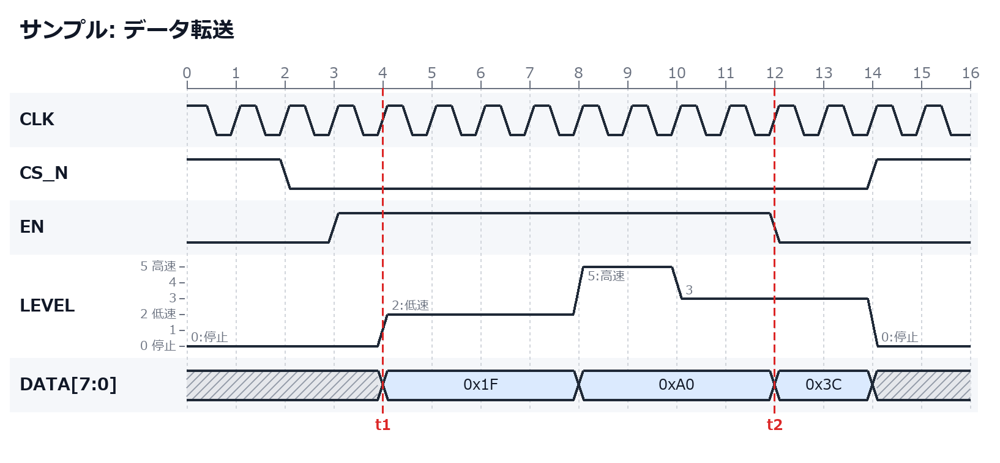

# Time Chart Maker

デジタル信号のタイミングチャート（タイムチャート）を、クリック操作またはテキスト記法で手軽に作成できるデスクトップアプリです。



## 必要なもの

- Python 3.10 以上（Tkinter 付き）
- Pillow（PNG 出力用）

```sh
pip install -r requirements.txt
```

## 起動

```sh
python main.py                       # サンプル入りで起動
python main.py examples/sample.json  # ファイルを開いて起動
```

## 画面操作

| 操作 | 内容 |
| --- | --- |
| セルをクリック | High / Low を切り替え（ドラッグで連続入力） |
| バス行のセルをクリック | 値を入力（空欄 = 前の値を継続、`x` = 不定） |
| 多値行のセルをクリック | クリックした高さの値にする（ドラッグで高さに合わせて連続入力） |
| セルを右クリック | High/Low/不定/クロック/バス値の設定、サイクルの挿入・削除 |
| 信号名をドラッグ | 並べ替え |
| 信号名をダブルクリック | 名前の変更（右クリックで移動・複製・削除） |
| 目盛り（数字の行）をクリック | マーカーの追加・削除 |
| Ctrl + ホイール | 拡大・縮小 |
| Ctrl+Z / Ctrl+Y | 元に戻す / やり直し |

ツールバーからは、信号・バス・クロック（周期や開始レベルを指定）・多値信号（最大値を指定）・マーカーの追加と、サイクル数・セル幅の変更ができます。

## テキスト記法

画面下部のエディタは図と同期しています。どちらを編集しても、もう一方に反映されます。

```text
@title サンプル: データ転送
CLK       : p...............
CS_N      : 1.0...........1.
EN        : 0..1........0...
LEVEL     : 0...2...5.3...0. | max=5, 0=停止, 2=低速, 5=高速
DATA[7:0] : x...=...=...=.x. | 0x1F, 0xA0, 0x3C
@marker 4 t1
@marker 12 t2
```

| 文字 | 意味 |
| --- | --- |
| `0` / `1` | Low / High |
| `2`〜`9` | 多値信号のレベル（`\| max=N` で最大値を指定。省略時は 5） |
| `p` / `n` | クロック 1 周期（High から / Low から） |
| `x` | 不定 |
| `=` | バス値（`\|` の後ろに書いた値を順に使う） |
| `.` | 直前の状態を継続 |

- 多値信号は 0〜最大値（最大 9）の値を階段状に描き、各区間に値を表示します。最大値は信号名の右クリック →「最大値を設定」でも変更できます。
- `| max=5, 0=停止, 2=低速` のように `値=意味` を書くと、各区間に「2:低速」、信号名の右側の一覧に「2 低速」と表示します。意味のない値は数字だけを表示します。信号名の右クリック →「値の意味を設定」でも入力できます。
- `@title タイトル`：タイトル
- `@marker 時刻 ラベル`：マーカー線
- `#` で始まる行：コメント（図を編集するとコメントは消えます）

## 保存と出力

- **保存 / 開く**：JSON 形式（`.json`）。セル幅と補助線の設定も一緒に保存されます。
- **PNG 出力**：高解像度（2 倍）で出力します。
- コマンドラインからも出力できます：`python -m timechart.export input.json output.png`

## テスト

```sh
python -m pytest
```
